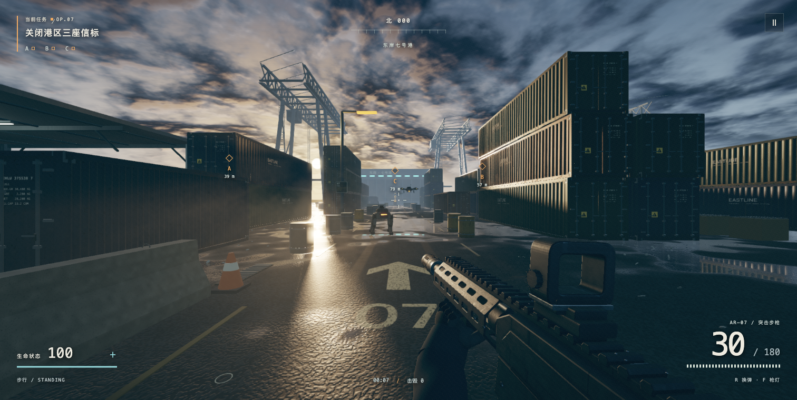

# 雾港：断电行动

为陈成制作的原创浏览器 FPS，当前版本 1.0.0。场景、枪械、机械守卫与任务独立编写；参考小体积程序化射击游戏的技术思路，没有复用《几猫》的游戏代码或美术资源。

1.0 重建了港区入口、错落堆垛、吊机桁架、检修棚和撤离艇；按真实尺寸重建 AR–07 的镂空护木、薄导轨、机匣与手部。新增可开关枪灯，重做不规则积水、海面多向波浪、金属微表面和局部做旧，修复静态实例被重复合批而丢失构件的问题。流畅档也保留基础阴影。

全部资源在浏览器内生成，单文件离线版约 0.82 MiB。具体实现及验收范围见 `docs/画质升级-1.0.0.md`。

[在线试玩](https://www.daguojueqi.site/mist-harbor/) · [下载离线版](https://github.com/chencheng666/mist-harbor/releases/tag/v1.0.0)



## 开始试玩

直接用浏览器打开项目根目录下的 `雾港-直接打开.html`。这个文件包含运行所需的代码，无需联网、安装依赖或启动后端。

也可以在本目录运行：

```sh
python3 -m http.server 8767 --bind 127.0.0.1 --directory dist
```

然后访问 `http://127.0.0.1:8767/`。推荐使用启用硬件加速的桌面 Chrome、Edge 或 Safari。

## 操作

| 按键 | 操作 |
| --- | --- |
| W / A / S / D | 移动 |
| 鼠标 | 视角；无法捕获鼠标时按住鼠标拖动 |
| 方向键或 I / J / K / L | 键盘转动视角 |
| 左键或 Enter | 连续射击 |
| 右键或 Q | 瞄准 |
| R | 换弹 |
| F | 开关枪灯 |
| Shift | 冲刺 |
| Space | 跳跃 |
| C 或 Ctrl | 蹲伏 |
| 按住 E | 关闭信标、使用补给 |
| Esc 或 P | 暂停 |

触屏设备显示左摇杆、右侧视角区，以及开火、瞄准、换弹、跳跃、交互、枪灯按钮。开火按钮可边按边拖动瞄准。

## 任务与战斗

- 关闭 A、B、C 三座橙色信标，再进入东侧蓝色撤离区。
- 敌人为四旋翼机械无人机、地面四足守卫，具备视线检测、攻击和网格绕障。
- 步枪具有 30 发弹匣、备用弹药、后坐力、射击散布、近距离部位伤害和命中提示。
- 绿色补给箱补充生命与弹药；脱离交火 7 秒后缓慢恢复生命。
- 暂停菜单可以切换流畅、均衡、精细画质、自动画质开关、视角灵敏度和声音。自动画质优先参考 GPU 计时，避免把浏览器限帧误判为显卡吃紧。
- 完成或失败后显示用时、信标数、击毁数与命中率，可以重新开始。

## 源码

- `dist/art.js`：程序化材质、天空环境、PCSS 式阴影、HDR 后处理和性能预算。
- `dist/terrain.js`：连续湿地、平面反射、GPU 雨、海面和遮雨区域。
- `dist/world.js`：港区、检修棚、工业道具、实例化批次和信标。
- `dist/geometry.js`：守卫固定零件按材质合并。
- `dist/rifle.js`：AR–07、准直分划、湿润微表面、弹簧与换弹。
- `dist/weapon.js`：机械守卫模型、四足 IK、声音合成、空间定位和混响。
- `dist/effects.js`：火花、弹壳、烟雾、弹痕与曳光对象池。
- `dist/game.js`：输入、碰撞、感知与战斗、A*、任务和 UI。
- `dist/style.css`：主界面、HUD 与触屏布局。
- `dist/vendor/`：随包提供的 Three.js 0.160.1 及原始 MIT 许可证。

0.2 使用的扫描图来源记录保留于 `docs/历史扫描材质/`，不再属于当前运行时资源。
修改后运行 `node scripts/package.mjs`，重新生成单文件版本。`dist` 可直接部署到静态网站服务器，页面运行不依赖 CDN。

## 验收方式

正常地址只开放只读运行快照 `window.__harbor.snapshot()`。在本地地址加 `?test=1` 可启用受控验收入口，测试射击、碰撞、补给、三座信标、结算与重新部署；正常试玩地址不启用测试入口。

桌面浏览器及触屏模拟验收结果保存在本机 `验收` 目录。模拟触屏不代表已完成实体手机 Safari 验收。
