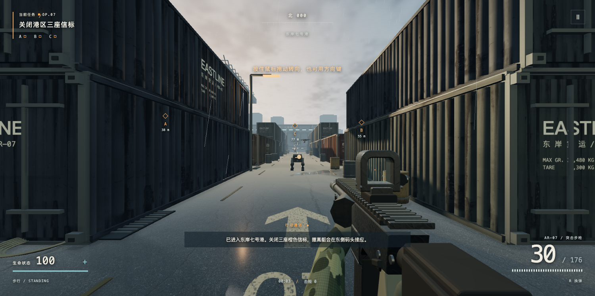
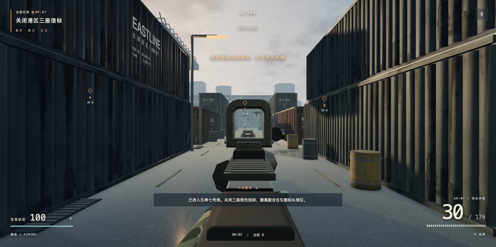

# 雾港：断电行动

一个基于 Three.js 的原创浏览器单人 FPS。雨港、机械守卫、步枪射击，以及关闭三座信标后登船撤离的任务。当前版本 **0.2.0**。

**[在线试玩](https://www.daguojueqi.site/mist-harbor/)** · **[下载离线版](https://github.com/chencheng666/mist-harbor/releases/latest)** · [架构与核心代码](docs/architecture.md) · [开发用量与体积](docs/development-metrics.json)



## 玩法

- 关闭 A、B、C 三座橙色信标，再前往东侧蓝色撤离区。
- 机械无人机和四足守卫具有视线检测、追击、绕障和攻击行为。
- 步枪具备射击散布、后坐力、瞄准、换弹、命中提示和弹药管理。
- 绿色补给箱补充生命与弹药；脱离交火后缓慢恢复生命。
- 可切换流畅、均衡、精细三档画质，支持桌面键鼠与触屏按钮。

这是持续迭代的个人游戏原型，场景与枪械主要通过程序化几何实现。

## 直接运行

在 Releases 下载 `MistHarbor-v0.2.0-offline.html`，用浏览器打开即可。纹理与脚本已经内嵌，无需联网或安装依赖。

开发时可从仓库根目录启动静态服务：

```sh
python3 -m http.server 8767 --bind 127.0.0.1 --directory dist
```

访问 `http://127.0.0.1:8767/`。推荐使用启用硬件加速的桌面浏览器。

## 操作

| 按键 | 操作 |
| --- | --- |
| W / A / S / D | 移动 |
| 鼠标 | 转动视角；无法捕获鼠标时按住拖动 |
| 方向键 / I J K L | 键盘转向 |
| 左键 / Enter | 连续射击 |
| 右键 / Q | 瞄准 |
| R | 换弹 |
| Shift | 冲刺 |
| Space | 跳跃 |
| C / Ctrl | 蹲伏 |
| 按住 E | 信标或补给交互 |
| Esc / P | 暂停 |

触屏设备显示左摇杆、右侧视角区与开火、瞄准、换弹、跳跃、交互按钮。开火按钮支持边按边拖动瞄准。



## 代码结构

```text
dist/
  index.html       页面入口、菜单、HUD
  style.css        桌面和触屏布局
  art.js           PBR 资源、环境反射、后处理
  world.js         港区几何、天气、反射与交互物
  rifle.js         第一人称枪械、手套与换弹动画
  weapon.js        机械守卫模型、合成音效
  game.js          输入、物理、战斗、导航、任务
  assets/materials 扫描纹理、来源与许可
  vendor/          Three.js 与 MIT 许可证
```

运行时使用原生 JavaScript 与 Three.js，不需要 React、Vue 或业务后端。静态目录可以放到普通静态服务器上。

修改后执行 `node scripts/package.mjs`，重新生成单文件离线版。打包脚本需要本地 Node.js，游戏运行不需要。

## 开发记录

正式开发与画质升级两轮，从 2026-11-11 11:00:45 至 11:53:03，跨度约 **52 分钟 18 秒**，包含浏览器检查、素材下载、部署及验证等待。

会话记录共处理 **18,066,390 tokens**，其中缓存输入 **17,823,616**；非缓存输入 **131,936**，输出 **110,838**。非缓存输入与输出合计 **242,774**。这些是本地记录的处理量，不等同人民币账单；不包含前置参考评估及后续 GitHub、文章制作。

0.2.0 的静态源文件合计 **6,118,716 字节（5.84 MiB）**；单文件离线版 **7,893,868 字节（7.53 MiB）**。详见 [统计口径](docs/development-metrics.json)。

## 验证范围

已检查桌面移动、射击、换弹、墙体遮挡、碰撞、信标任务、撤离结算、失败重试，以及浏览器触屏模拟。触屏模拟不等于实体手机 Safari 验收。

正常页面只提供只读运行快照 `window.__harbor.snapshot()`。显式添加 `?test=1` 可以使用测试控制入口；正常地址不启用。客户端游戏状态不作为服务端可信数据。

## 许可与素材

代码采用 [MIT](LICENSE) 许可。Three.js 的原始许可证位于 `dist/vendor/THREE-LICENSE.txt`。Poly Haven 扫描材质按 CC0 提供，原始来源和 SHA256 位于 [材质目录](dist/assets/materials/LICENSE.md)。

程序化场景、枪械与玩法独立编写，没有使用参考游戏的代码或美术资源。

作者：陈成。
