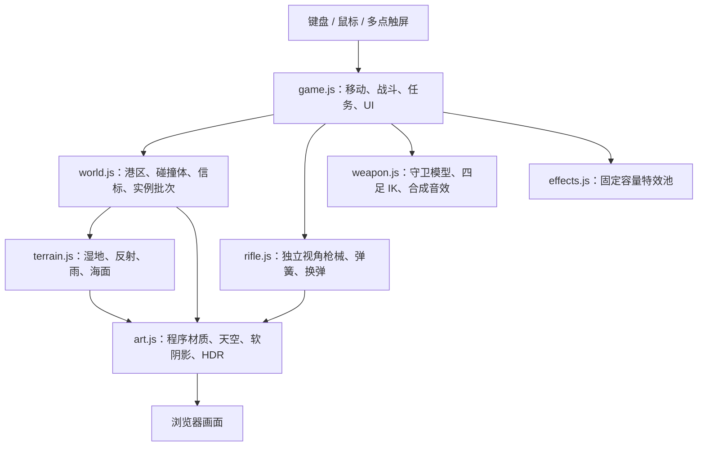

# 雾港 1.0 架构

所有内容为浏览器原生 JavaScript，使用随包 Three.js 0.160.1，无构建依赖与远程 CDN。场景、材质、枪械、守卫和声音在浏览器运行时生成。

## 关键约束

- 普通静态部件按材质合并；重复部件实例化；运动部件保持独立变换。已经实例化的对象不能再次按普通网格合并。
- 碰撞体服务于移动与导航，射击射线检测可见主体或匹配尺寸的碰撞代理，避免穿墙伤害。
- 地面湿度的 CPU 与 GLSL 判定采用同一公式，脚步音与视觉湿区一致。
- 枪械使用独立相机，枪口与抛壳位置通过两相机视场角补偿映射回世界。
- 阴影、反射、AO、雨量和像素预算由画质档控制，自动分辨率优先依据 GPU 计时。
- 正常入口只提供只读快照；仅显式 `?test=1` 地址开放可写测试接口。

离线打包脚本将 HTML、样式、脚本与 Three.js 许可证合并为一个文件。1.0 的源码和验收摘要见同目录的版本文档；`development-metrics.json` 是早期 0.2 开发记录，不代表 1.0 开发总耗时或 Token。
